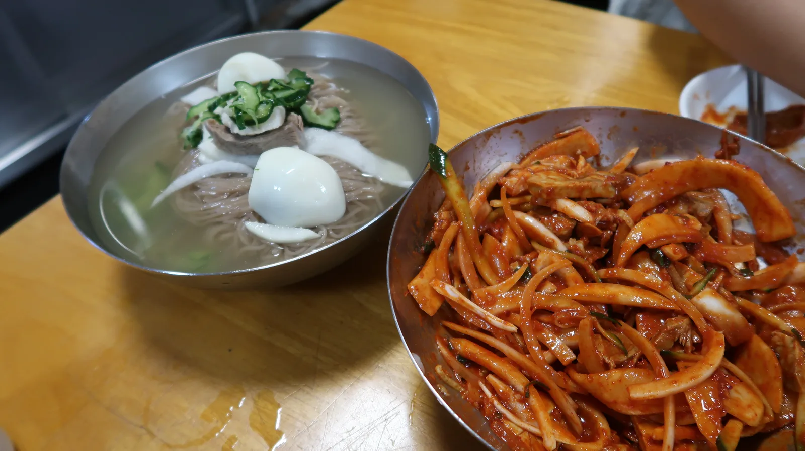
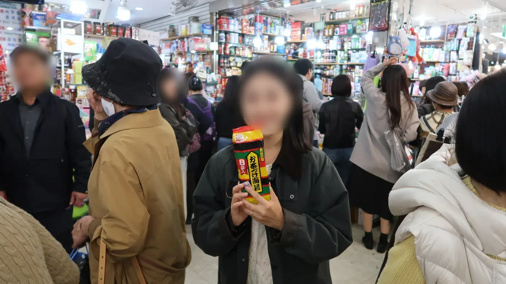
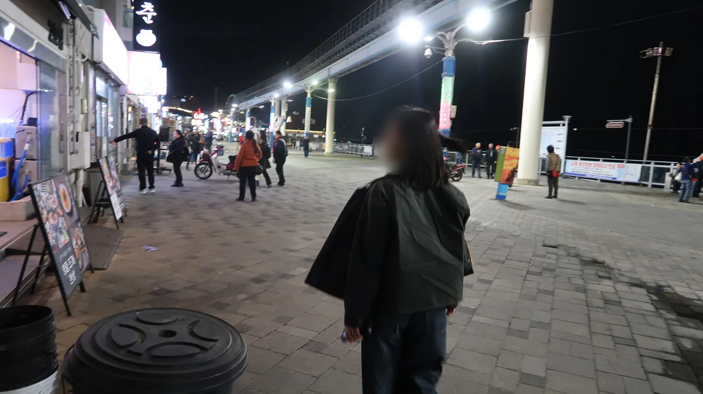
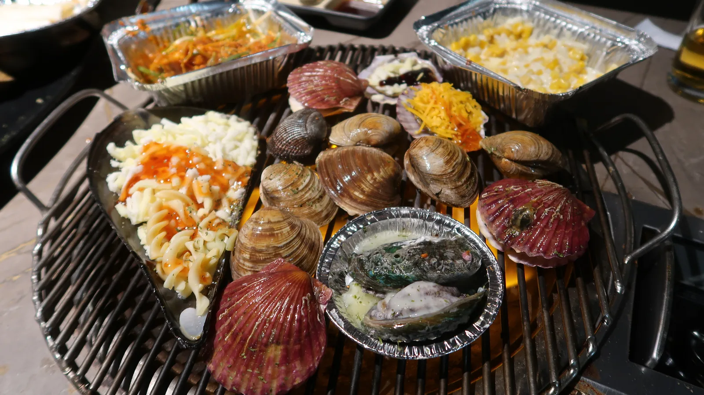
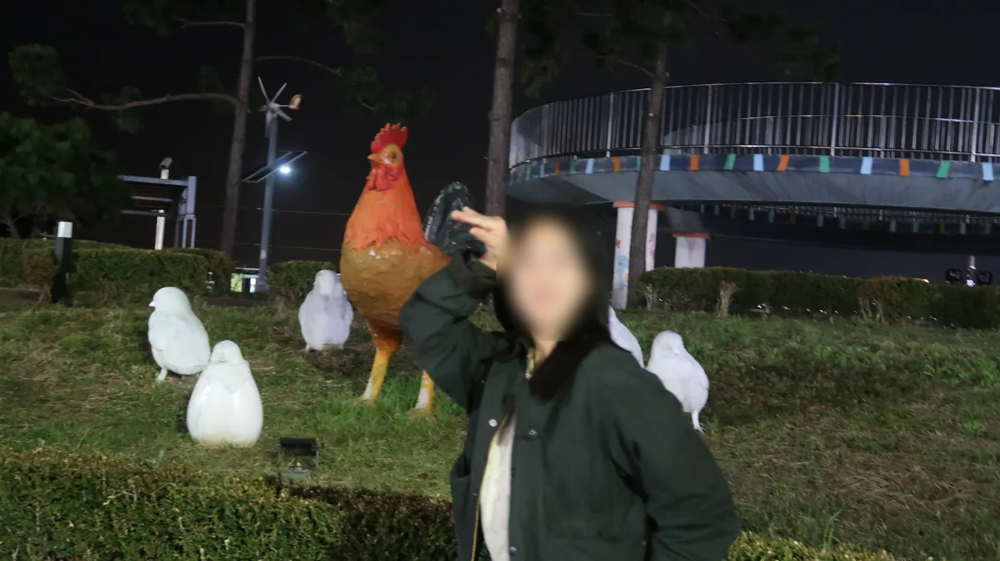

<!-- 사진: 시장 골목 → 02 / 그릇 상가 → 01 / 부원면옥 입구 빈대떡 → 03 / 냉면 → 04 / 과자 가게 → 05 / 월미도 밤 산책로 → 06 / 조개구이 → 07 / 닭 조형물 → 08. 모두 준구가 찍은 사진, 아내 얼굴과 행인 얼굴은 흐리게 처리 -->

10월 30일 금요일, 아내와 남대문시장에 갔다가 사람이 너무 많아 동묘는 건너뛰고 월미도로 넘어갔다.

## 금요일 점심에도 꽉 찬 남대문시장

원래 우리 루트는 정해져 있었다. 남대문시장을 가볍게 구경하고 그릇을 좀 보다가 동묘로 넘어가는 길이다. 그런데 요즘 남대문시장이 핫플이 돼서 그런지, 금요일 점심인데도 사람이 엄청 많았다.

그릇 상가 안도 붐볐다. 접시와 냄비, 수저가 천장 가까이까지 쌓여 있었고, 아내는 그릇 앞에서 자주 멈춰 섰다. 우리는 30분 넘게 그 안을 돌았다.

## 부원면옥 냉면

점심은 부원면옥에서 먹었다. 입구 철판에서는 빈대떡이 쉬지 않고 부쳐지고 있었고, 벽에는 다녀간 사람들의 사인이 빼곡했다.

물냉면과 비빔냉면을 시켰다. 밥은 맛있었다.

밥을 먹고는 수입 과자 가게를 구경했다. 아내가 고른 과자가 바구니에 하나둘 쌓였다.

## 세 시간 반 걸린 월미도

사람이 너무 많아서 이번에는 동묘를 패스했다. 시장에서 조금 더 놀다가 월미도로 출발했는데, 차가 너무 막혀서 세 시간 반이 걸렸다. 도착하니 이미 밤이었고, 바다 앞 산책로는 낮의 시장과 달리 사람이 드물었다.

저녁은 조개구이였다. 불판에 치즈 콘과 조개가 같이 올라갔다.

돌아가기 전에 커다란 닭 조형물 앞에서 아내 사진을 찍었다.

