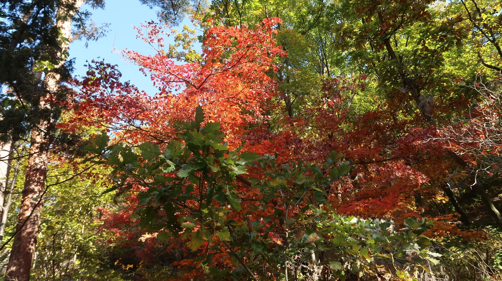
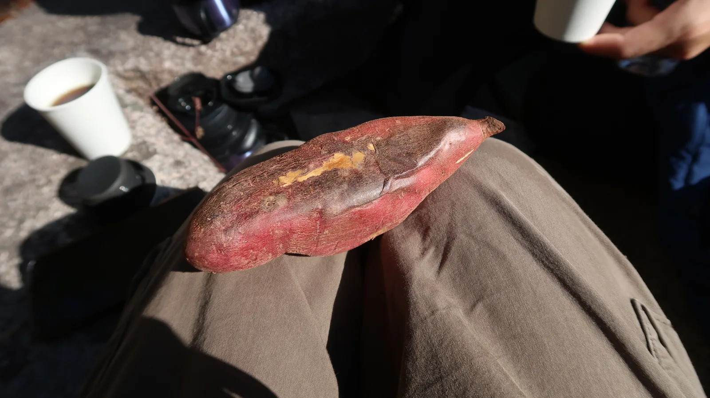
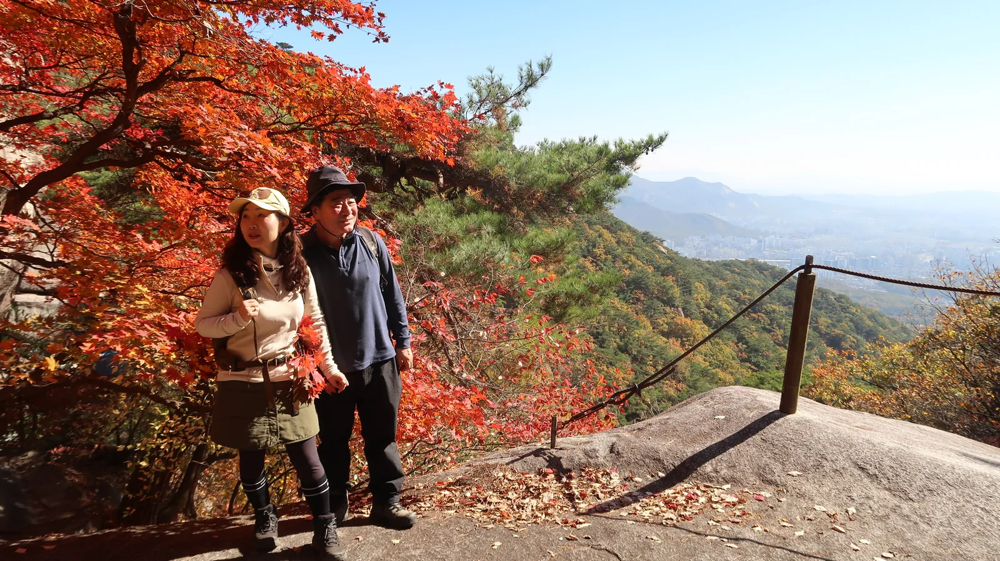
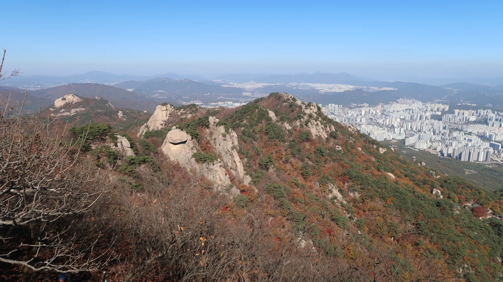

<!-- 사진: 넷이 찍은 셀카 → 01 / 입구 인파 → 02 / 단풍길 → 03 / 고구마 쉬는 시간 → 04 / 바위 아래 절 → 05 / 부모님 단풍 전망 → 06 / 능선 풍경 → 07 / 하산 후 식당 → 08. 모두 준구가 찍은 사진, 아내 얼굴은 흐리게 처리 -->

10월 31일, 부모님과 아내, 나 넷이서 도봉산에 올라 단풍을 봤다.

## 입구부터 사람이 많았다

아침 9시에 집을 나섰다. 10시 20분쯤 도봉산 입구에 닿았는데, 토요일이라 등산객이 길을 꽉 메우고 있었다.

탐방로에 들어서자 단풍이 시작됐다. 노란 잎 사이로 빨간 단풍이 섞여 있었다.

## 쉬면서 먹은 고구마

11시 반쯤 바위에 앉아 쉬었다. 싸 온 고구마를 나눠 먹고 커피를 마셨다.

조금 더 오르니 큰 바위 밑에 자리 잡은 절이 나왔다. 등산객들이 거기서 숨을 돌리고 있었다.

절 근처 바위에서는 빨간 단풍 너머로 시내가 내려다보였다. 부모님은 그 앞에 나란히 서서 사진을 찍었다.

## 위로 갈수록 바위

1시쯤부터는 나무가 드물어지고 바위 능선과 그 아래 아파트 단지가 한눈에 들어왔다. 1시 반쯤 바위 봉우리 앞에서 넷이 같이 셀카를 찍었다. 맨 위 사진이 그때 찍은 것이다.

## 내려와서 한 상

오후 4시쯤 내려와 입구 식당가에 들어갔다. 안주와 전을 시켜 놓고 하루를 마무리했다.

