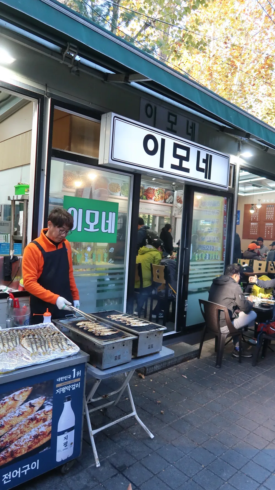

<!-- 사진: 넷이 찍은 셀카 → 01 / 입구 인파 → 02 / 단풍길 → 03 / 고구마 쉬는 시간 → 04 / 바위 아래 절 → 05 / 부모님 단풍 전망 → 06 / 능선 풍경 → 07 / 이모네 간판 → 09 / 껍데기 → 08. 모두 준구가 찍은 사진, 아내 얼굴은 흐리게 처리 -->

10월 31일, 가을 산을 볼 수 있는 마지막 주말이라 부모님 산행에 아내와 함께 끼어 도봉산에 올랐다.

## 원래는 부모님 두 분만 가는 산행이었다

원래는 엄마 아빠 두 분만 가시는 일정이었다. 그런데 아내가 먼저 「시부모님이랑 같이 갈까?」 하고 제안했다. 다음 날 비 예보가 있어서 이번 주가 가을 산을 볼 수 있는 마지막 주였다. 그래서 우리가 조인하기로 했다.

아침 9시에 집을 나섰다. 날씨가 좋았다. 10시 20분쯤 도봉산 입구에 닿았는데, 토요일이라 등산객이 길을 꽉 메우고 있었다.

## 깜짝 놀랄 만큼 많았던 외국인

이날 제일 놀란 건 외국인이었다. 한두 명이 아니라 단체만 몇십 팀은 본 것 같다. 젊은 사람도 많았다. 요즘 도봉산이 관광 필수 코스에 들어가 있나 싶었다.

탐방로에 들어서자 단풍이 시작됐다. 노란 잎 사이로 빨간 단풍이 섞여 있었다.

11시 반쯤 바위에 앉아 쉬었다. 싸 온 고구마를 나눠 먹고 커피를 마셨다.

조금 더 오르니 큰 바위 밑에 자리 잡은 절이 나왔다. 등산객들이 거기서 숨을 돌리고 있었다.

절 근처 바위에서는 빨간 단풍 너머로 시내가 내려다보였다. 부모님은 그 앞에 나란히 서서 사진을 찍었다.

## 웅장한 기암괴석

1시쯤부터는 나무가 드물어지고 바위 능선이 한눈에 들어왔다. 도봉산 기암괴석은 진짜 웅장했다. 단풍도 너무 예뻤고, 무엇보다 넷이 같이 가서 좋았다. 1시 반쯤 바위 봉우리 앞에서 넷이 찍은 셀카가 맨 위 사진이다.

## 내려와서 이모네

오후 4시쯤 내려와 역 쪽으로 걸어가 「이모네」라는 가게에 들어갔다.

껍데기가 맛있었고, 산에서 내려와 마신 막걸리는 시원했다.

