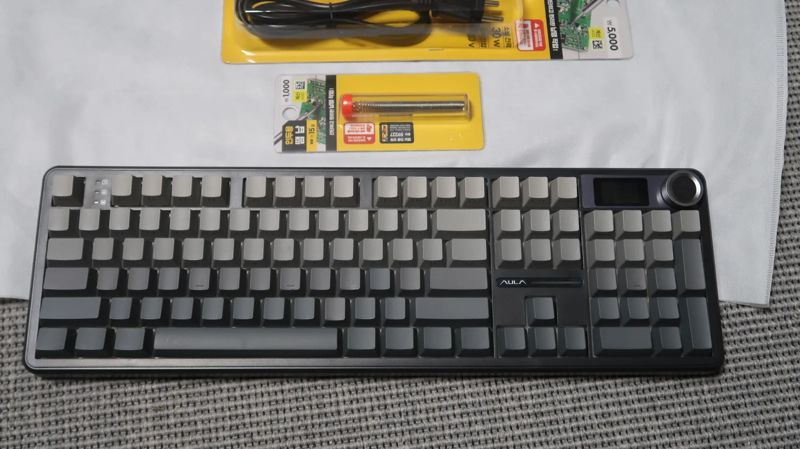
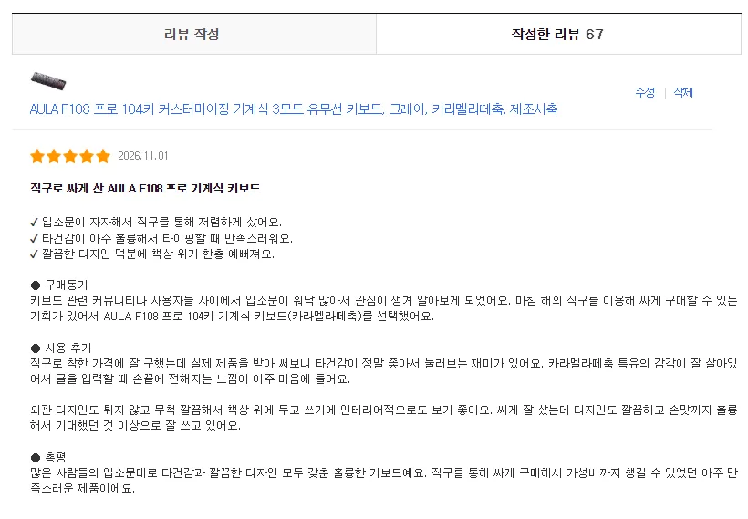
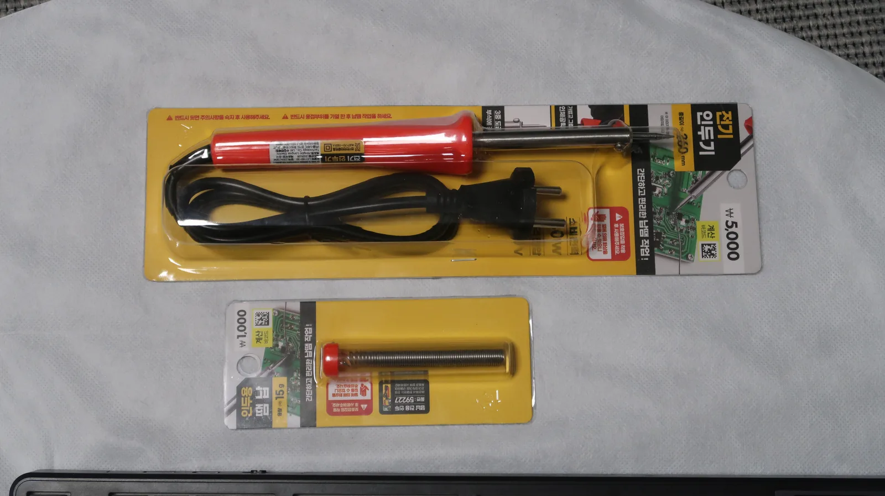
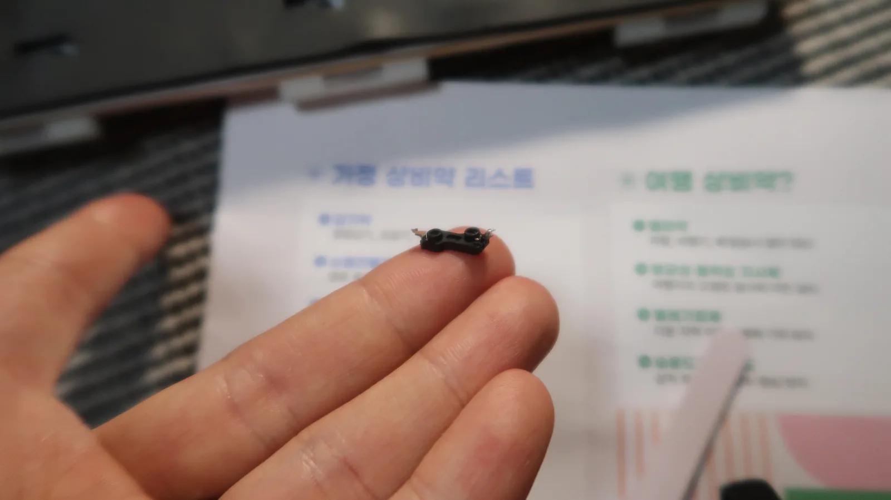
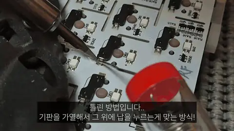
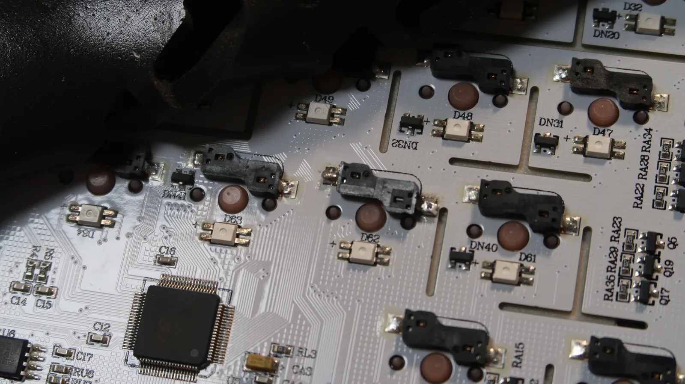
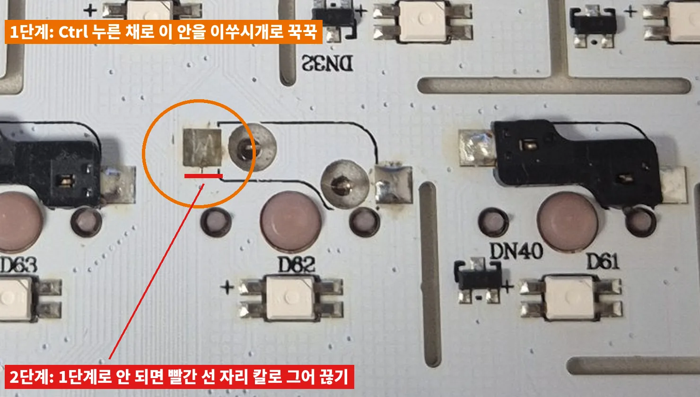
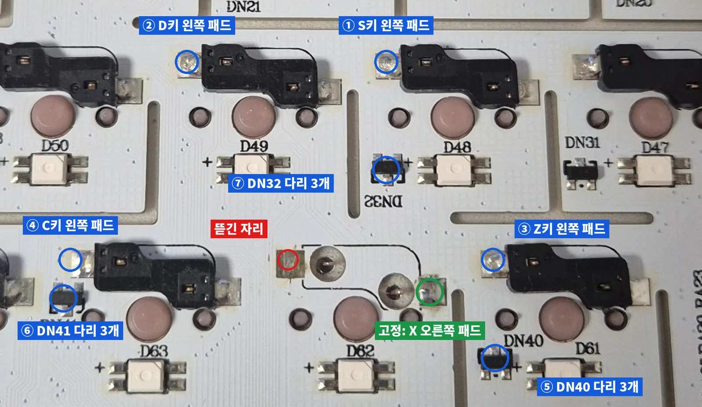
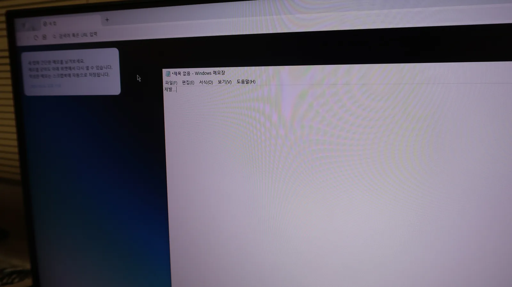
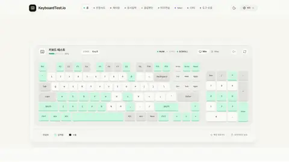

<!-- 사진: 도입 → 분해 전 키보드 / 구매 → 쿠팡 리뷰 캡처 / 축 교체 → 피치축 꽂은 모습 / 준비 → 다이소 인두기와 납 / 분해 → 키캡 뽑기, 지렛대, 배터리 / 1차 납땜 → 인두기, 튀어나온 소켓, 떨어진 소켓, 1차 수리 / 쇼트 → 뜯긴 패드 자리, 짝 지도, 두 줄 원리 / 돌파 → 이쑤시개 위치 / 우회 → X 연결 후보, 랜선 전선, D63 연결 / 결과 → 메모장 테스트 -->

독거미 AULA F108 프로의 X키가 안 눌려서 인두기를 들었다가 쇼트와 뜯긴 패드까지 만났고, 클로드와 추측을 하나씩 실제로 확인해 지워 가며 옆 키 패드에 전선을 이어 살렸다.

🙋🏻‍♂️ 키보드 납땜, 인두기 살짝 대면 끝난다던데요? 🙋🏻‍♀️ 저도 그런 줄 알았습니다ㅎ;

<small>분해 전의 독거미 F108 프로, 이때까지만 해도 X 하나만 고치면 끝나는 줄 알았던 키보드</small>

주말에 키보드를 뚝딱거리며 클로드와 놀고 있었습니다. 그런데 옆에서 아내가 한마디 하더군요. 「키보드 너무 세게 치는 거 아니야?」 🤔

조용히 치겠다고 대답은 했는데요. 그 말이 마음속에 계속 남아 있었습니다. 그러다 쿠팡에서 예쁜 키보드를 로켓직구로 싸게 파는 걸 봤고, 바로 샀습니다. 여기까지는 평범한 쇼핑 이야기였다. 😛

이 글은 그 키보드의 X키 하나에서 시작된 수리 기록입니다. 납땜은 처음이었고, 멀티미터도 없었습니다. **그런데 왜 중간에 포기하지 않고 끝까지 갈 수 있었을까요?**

> **목표** 안 눌리는 X키 살리기 
> **난관** 납땜 중 뜯겨 나간 패드, 두 줄 통째로 같이 눌리는 쇼트, 측정 도구 없음 
> **결과** 쇼트 제거, 옆 키 패드에 전선 우회로 X키 복구

## 첫 번째 박스📦 시끄러운 키보드와 안 눌리는 X

<small>쿠팡 로켓직구로 산 AULA F108 프로 카라멜라떼축과 클로드 자동화로 쓴 구매 리뷰</small>

산 제품은 AULA F108 프로 104키, 카라멜라떼축입니다. 리뷰도 클로드 자동화로 썼는데요. 키워드만 던지면 클로드가 글을 쓰고 등록 버튼까지 눌러 주는 방식입니다. 그런데 배송받고 몇 글자 쳐 보니 생각보다 시끄러웠습니다. 😫

마침 집에 놀고 있던 피치축이 있었습니다. 이 키보드는 스위치를 뽑아 바꿀 수 있는 핫스왑 방식이라 전부 갈아 끼웠습니다. 👀**<mark>조용해지려고 산 키보드였는데, 축을 바꾸는 순간 진짜 문제가 시작됐다.</mark>**

<small>원래 축을 뽑고 집에 있던 피치축으로 갈아 끼우는 중인 F108 프로</small>

테스트해 보니 X가 안 눌렸습니다. 다른 스위치로 바꿔 꽂아 보고 이것저것 해 봤지만 그대로였는데요. 네이버에서 검색해 보니 뒤 기판을 열어 인두기를 살짝만 갖다 대면 끝난다는 글이 있었습니다. [독거미 키보드 AULA F99 키 입력 불량 수리 글](https://blog.naver.com/ststeel/224044004123)을 참고했고, 하판을 열 때 배터리를 꼭 빼야 한다는 것도 이 글에서 알았습니다. 🤩

<small>퇴근길에 다이소에서 산 인두기와 실납</small>

바로 다이소에서 인두기와 납을 사서 퇴근했습니다. 납땜은 처음이었습니다.

<small>하판 고정 홈이 있는 자리 주변 키캡만 골라 뽑은 모습</small>

분해는 생각보다 쉬웠습니다. 하판을 고정하는 홈 주위 키캡만 뽑고, 딱딱한 걸 아무거나 홈에 넣어 지렛대처럼 툭 젖히면 됩니다. 살살 필요한 부분만 뜯으면 손쉽게 분리되는데요. 처음 열었을 때 배터리부터 뺐습니다. 👍

| 순서 | 한 일 |
|---|---|
| 1 | 하판 고정 홈 주위 키캡만 뽑기 |
| 2 | 딱딱한 도구를 홈에 넣고 지렛대처럼 툭 |
| 3 | 필요한 부분만 살살 뜯어 분리 |
| 4 | 열자마자 배터리 연결 빼기 |

<small>딱딱한 도구를 홈에 넣어 지렛대 원리로 하판을 여는 장면</small>

<small>처음 연 키보드 안쪽과 먼저 빼야 하는 배터리 선</small>

## 두 번째 박스📦 클로드와 추측을 하나씩 지워 간 과정

<small>처음 써 보는 다이소 인두기를 달구는 중</small>

인두기를 달구고 X 자리 뒷면을 봤습니다. 소켓 한쪽이 살짝 튀어나와 있었는데요. 이때는 그게 납이 들뜬 거라고만 생각했습니다. 💥**사실은 납이 아니라 기판의 구리 패드가 통째로 뜯겨 나온 상태였다.** 🤯

<small>자세히 보면 튀어나와 있는 X 자리 핫스왑 소켓, 이때는 패드가 뜯긴 줄 몰랐던 모습</small>

<small>아무것도 모르고 다시 붙이려던 X 자리 소켓</small>

아무것도 모르고 그 소켓을 다시 납땜했습니다. 소켓은 안 쓰는 F10 자리 것을 떼어 왔습니다. 1차 수리가 끝났을 때는 잘한 줄 알았습니다. 😎

<small>기판을 달구지 않고 녹인 납만 떨어뜨린 틀린 방법</small>

<small>당시에는 잘한 줄 알았던 1차 수리 모습</small>

결과는 더 나빠졌습니다. X는 여전히 안 눌렸고, 엉뚱한 키들이 둘씩 짝지어 같이 눌리기 시작했는데요. 키보드 테스트 화면과 메모장에서 하나씩 눌러 정리한 결과는 이랬습니다.

<small>한 번에 될 줄 알고 눌러 본 1차 수리 직후의 메모장</small>

| 누른 키 | 결과 |
|---|---|
| Ctrl 또는 Shift | 둘이 같이 눌림 |
| Alt | Z와 같이 눌림 |
| 스페이스 | B와 같이 눌림 |
| . | Fn과 같이 눌림 |
| ↑ | ↓와 같이 눌림 |
| A·S·D·F·G | 각자 잘 눌림 |
| C·V·N·M | 각자 잘 눌림 |

여기서부터 클로드와 본격적으로 주고받았습니다. 클로드가 맨 처음 내놓은 진단은 가로줄 두 개가 붙은 **라인 쇼트**였습니다. 같이 눌리는 짝이 전부 Shift 줄 키 하나와 그 바로 아래 Ctrl 줄 키 하나였기 때문입니다. 🤔

<small>기판 뒷면에 같이 눌리는 짝을 표시한 지도, 짝은 전부 바로 위아래로 붙은 소켓</small>

물론 처음부터 이렇게 깔끔하게 보인 건 아닙니다. 뜯긴 자리 사진을 올려 보니 X 왼쪽 패드 자리는 은색이 아니라 갈색이었습니다. 커터칼로 긁어 봐도 아무것도 안 나왔는데요. 다른 키 패드는 전부 은색이니 패드가 뜯긴 게 확실했습니다. 😮

<small>패드가 뜯겨 갈색 바탕만 남은 X 자리와 주변의 탄 플럭스 자국</small>

제가 「판떼기」라고 부르던 건 정식 명칭이 구리 패드였습니다. 스위치 다리를 붙잡는 얇은 금속판이고, 기판에 인쇄된 구리라서 다른 자리에서 떼어 붙일 수도 없습니다. ✔**<mark>떼어 올 수 있는 건 소켓뿐이고, 사라진 패드는 전선으로 대신 이어야 한다.</mark>**

멀티미터가 없으니 남은 방법은 하나였습니다. 의심 가는 곳을 하나 고치고, 다시 눌러 보고, 안 되면 지우는 겁니다. 클로드가 후보를 내면 제가 실제로 해 보고 결과를 알려 주는 식이었는데요. 그렇게 지운 추측을 모으면 이렇습니다.

| 추측 | 실제로 해 본 것 | 결과 |
|---|---|---|
| 뜨거울 때 전원 꽂아서 고장 | 클로드에게 물어봄. 5V 저전압이라 열 때문에 칩이 망가질 일은 거의 없다는 답 | 후보에서 뺌 |
| 기판 위 쇳조각 | 핀셋으로 제거 | 그대로 |
| 탄 플럭스 자국 | 닦아냄 | 그대로 |
| 구멍 주변 은색 동그라미가 납 | 클로드가 납으로 봤지만 제가 보니 스위치 다리였음 | 클로드 오판, 후보에서 뺌 |
| 납 뭉침 | 패드 위에 높이 쌓였을 뿐 옆 선에 닿지 않음 | 의미 없음 |
| X 스위치 다리가 구멍 안에서 닿음 | X 스위치를 뽑고 테스트 | 그대로 |

클로드도 틀렸습니다. 은색 동그라미를 납으로 본 것도, 처음에 「두 줄 전체가 한 몸이 된다」고 설명한 것도 그랬는데요. 그 줄에서도 혼자 잘 눌리는 키가 많지 않냐고 되묻자 설명을 바로 고쳤습니다. 가로줄이 붙어도 **같은 세로 자리에 위아래 키가 둘 다 있는 곳만** 엮인다는 겁니다. C·V·N·M이 멀쩡했던 건 아래 줄이 스페이스바라 짝이 없어서였습니다. 😮

<small>Shift 줄 선과 Ctrl 줄 선이 한 점에서 붙는 원리를 기판 위에 그린 그림</small>

이 설명은 검색으로도 확인했습니다. 키보드는 세로줄에 하나씩 신호를 주면서 가로줄을 읽는 구조라, 가로줄 두 개가 붙으면 위아래 키가 같이 찍힙니다([QMK 문서](https://develop-docs.qmk.fm/how_a_matrix_works)). 기판 쇼트인지 컨트롤러 칩 고장인지는 증상만으로 못 가른다는 것도 같이 알았습니다. 다만 작업한 자리가 정확히 엮인 두 줄 사이라는 점에서 기판 쪽에 걸었습니다. 😎

## 세 번째 박스📦 이쑤시개 하나와 옆 키 패드로 우회

멀티미터를 사러 가야 하나 싶었는데요. 클로드에게 안 사는 버전으로 생각해 보라고 했습니다. 돌아온 답은 키보드 테스터 화면 자체를 측정기로 쓰는 방법이었습니다. 🤩

<small>Ctrl을 누른 채 이쑤시개로 꾹꾹 눌러 볼 구역을 표시한 사진</small>

Ctrl을 누르고 있으면 화면에 Shift도 같이 켜집니다. 그 상태에서 뜯긴 자리 주변을 이쑤시개로 여기저기 꾹꾹 누르다가 Shift가 꺼지는 지점을 찾는 방법이었는데요. 이쑤시개는 전기가 안 통하니 결과를 흐릴 일도 없습니다. 그렇게 누르다가 「툭」 소리가 나더니 Shift가 따로 놀기 시작했습니다. 🤯

들려 있던 구리 선 끝이 아래 줄 선에 닿아 있다가 떨어진 것으로 보입니다. 💥**<mark>눈으로 못 찾던 쇼트를 이쑤시개 하나로 잡았다.</mark>**

남은 건 X였습니다. 패드가 뜯긴 쪽 다리를 어디에 이어야 할지 몰랐는데요. 클로드는 처음에 S키 쪽이 더 유력하다고 봤습니다. 대부분 키보드가 Z-A-Q, X-S-W처럼 비스듬히 같은 세로줄을 쓰기 때문이라는 이유였습니다. 납땜 전에 전선을 손으로 대 보고 확인하자는 방법은 키보드 커뮤니티 수리 사례에서 가져왔습니다([KeebTalk 사례](https://www.keebtalk.com/t/need-help-fixing-lifted-pads-hotswap-socket/20075)). 🤔

<small>X 오른쪽 패드를 고정점으로 두고 전선을 대 볼 후보 일곱 군데</small>

전선은 랜선에서 한 가닥 뽑아 양 끝 피복을 벗겨 썼습니다. 처음 납땜해 이었을 때는 X 말고 다 잘되는데 X만 안 됐는데요. 알고 보니 소켓을 붙인 뒤에는 스위치를 꽂아 누른 채로 전선을 대야 했습니다. 소켓 두 다리는 스위치가 눌려야만 이어지기 때문입니다. 😫

<small>랜선에서 한 가닥 뽑아 양 끝 피복을 벗긴 전선</small>

<small>소켓 왼다리에 단 전선을 옆 기판 패드에 땜질하는 모습</small>

스위치를 꽂고 다시 대 보니 결과가 나왔습니다. 위쪽 D49, D48 패드에 대면 D가 찍혔습니다. 패드가 뜯긴 쪽 다리가 이미 D와 같은 선에 이어져 있다는 뜻이었는데요. 그리고 바로 옆 D63 패드에 대자 X가 떴습니다. 클로드가 유력하다던 S도, 그다음 후보 D도 아니었다. 😮

<small>X 소켓과 바로 옆 D63 패드를 잇는 전선 경로</small>

원래 위쪽 기판으로 이어지던 연결을 옆 기판으로 돌려 이은 셈입니다. 안 누를 때는 조용하고 누를 때만 X가 한 번 찍혔습니다. ✔**<mark>정답 자리는 추측이 아니라 전선을 직접 대 본 결과로 찾았다.</mark>**

<small>수리 뒤 메모장에서 X 입력을 확인하는 화면</small>

<small>수리 뒤 키보드 테스트 사이트에서 확인한 X 입력</small>

한계도 하나 남았습니다. X와 C를 동시에 누르면 안 됩니다. 키마다 있어야 할 전용 다이오드를 X가 C 것을 빌려 쓰는 구조라서인데요. 일상 채팅에서는 전혀 문제가 없어서 그대로 두고 조립했습니다. 소켓을 F10에서 떼어 온 것도 지나고 보니 Pause에서 뗄 걸 그랬습니다. 😛

| 남은 것 | 상태 |
|---|---|
| X와 C 동시 입력 | 안 됨. X 전용 다이오드 다리로 옮기면 고칠 수 있음 |
| F10 | 소켓을 떼어 와서 비어 있음. Pause 소켓을 옮기거나 키 설정으로 바꿀 수 있음 |
| X 소켓 | 한쪽 패드가 없어 약함. 스위치를 뺄 때는 뒤에서 소켓을 받쳐야 함 |

## 포기할 수도 있었는데

솔직히 중간에 포기할 수도 있었습니다. 쇼트가 났을 때도, 쇳조각을 빼고 탄 자국을 닦고 스위치까지 뺐는데 그대로였을 때도 그랬는데요. 그런데 클로드와 주고받을 때마다 다음에 해 볼 것이 하나씩 나왔고, 될 것 같은 느낌이 계속 들었습니다. 🤔

클로드가 한 일은 정답을 맞히는 게 아니었습니다. 증상을 듣고 후보를 내고, 제가 해 본 결과로 후보를 지우고, 막히면 다른 방법을 내놓는 일이었는데요. 사진을 올리면 어디를 봐야 하는지 그 위에 직접 표시해 줬습니다. 틀린 추측도 꽤 있었지만 확인하면 바로 지워졌습니다. 💰**<mark>정답을 아는 사람이 없어도, 추측을 하나씩 실제로 확인해 지워 가면 길이 나온다.</mark>**

납땜 처음 해 보는 사람이 멀티미터도 없이 뜯긴 패드를 살렸습니다. 안 될 것도 되게 하는 AI 시대가 좋다는 생각이 들었다. 어쩌면 진짜 고칠 수 있느냐는 실력보다, 다음에 해 볼 것이 계속 나오느냐에서 갈리는 게 아닐까요? 😎

독거미 키보드나 핫스왑 기판을 고치다 비슷하게 막히셨다면 편하게 남겨 주세요.

참고한 글

| 출처 | 내용 |
|---|---|
| [독거미 키보드 AULA F99 키 입력 불량](https://blog.naver.com/ststeel/224044004123) | 하판 분해, 배터리 분리, 인두기로 다시 붙이는 방법 |
| [QMK: How a Keyboard Matrix Works](https://develop-docs.qmk.fm/how_a_matrix_works) | 가로줄·세로줄 매트릭스와 다이오드 원리 |
| [KeebTalk: Need help fixing lifted pads Hotswap socket](https://www.keebtalk.com/t/need-help-fixing-lifted-pads-hotswap-socket/20075) | 뜯긴 핫스왑 패드를 전선으로 우회하는 사례와 연결 자리 찾는 법 |
