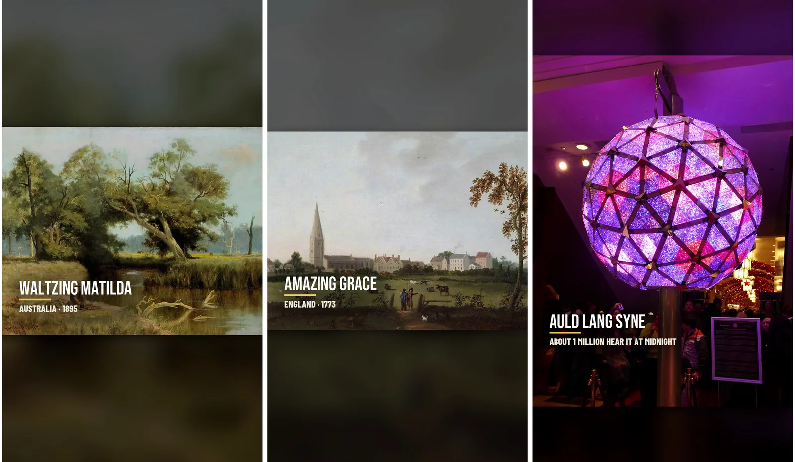
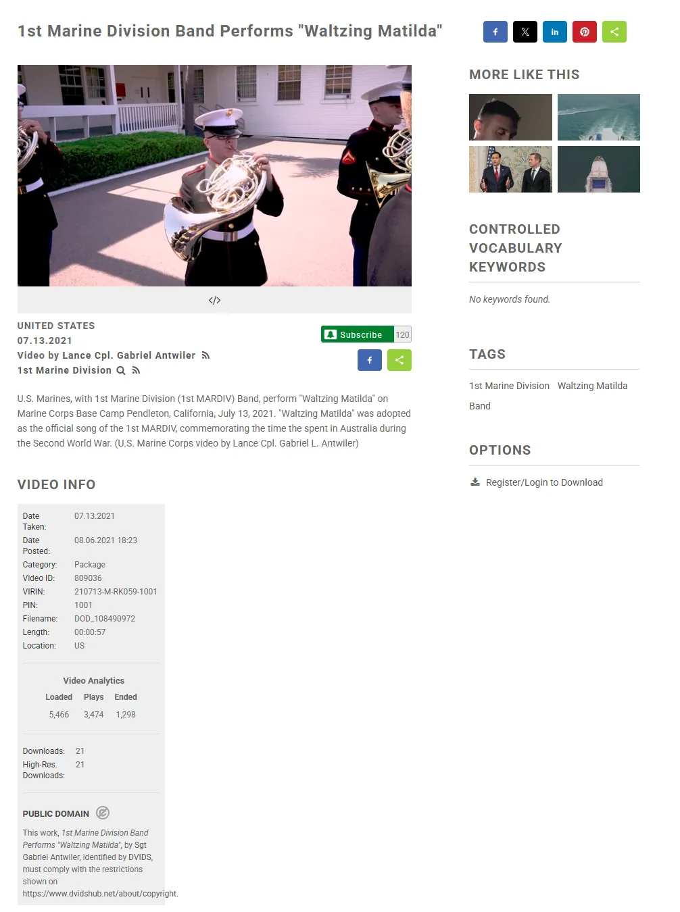
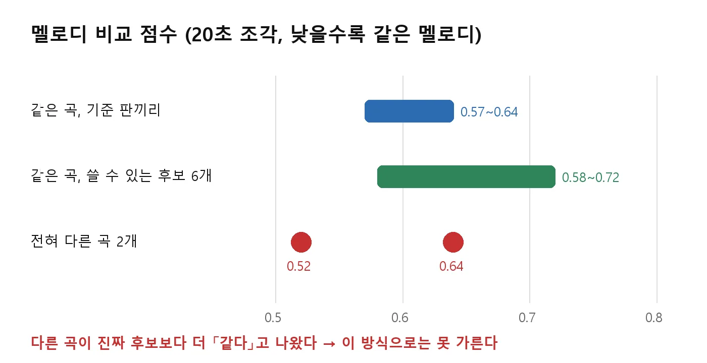
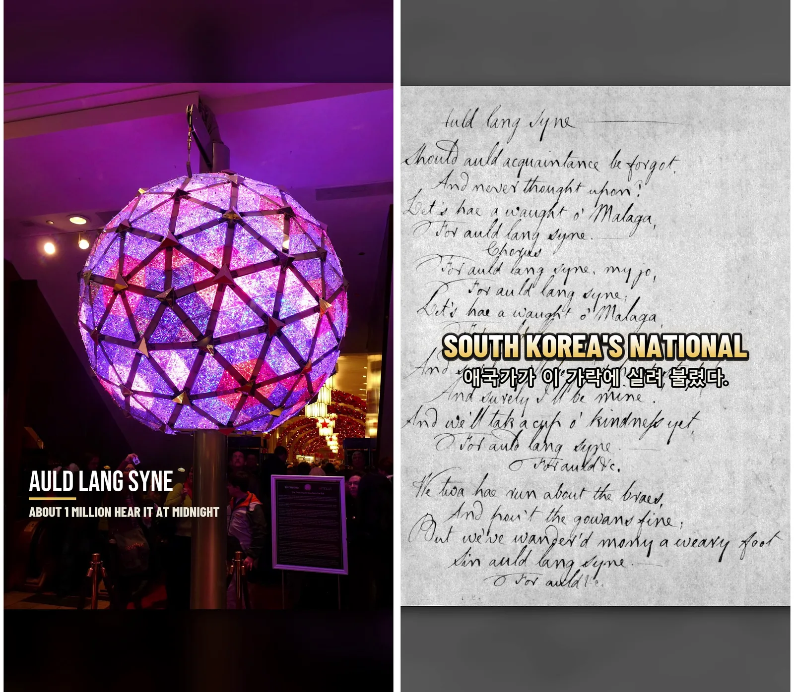

나라마다 누구나 아는 노래 한 곡과 그 노래가 생긴 이야기를 60초 쇼츠로 만들고 있다. 곡은 저작권이 끝난 것만 쓰고, 소리는 AI로 만들지 않고 실제 연주 녹음만 쓴다. 이틀 동안 세 편을 만들었다.

<small>세 편의 첫 화면. 호주 Waltzing Matilda, 미국 편으로 만든 Amazing Grace, 스코틀랜드 Auld Lang Syne</small>

## 전쟁 채널에 노래를 왜 넣나

6·25 참전 22개국을 한 나라씩 다루는 채널 Korea Remembers를 하고 있다. 여기에 그 나라 노래 이야기를 얹자는 생각이 먼저 나왔는데, 전쟁과 엮으려니 억지였다. 그래서 채널은 같이 쓰되 재생목록을 따로 만들고, 규칙을 갈랐다.

| 항목 | 전쟁 편 | 노래 편 |
|---|---|---|
| 이야기 | 그 나라 부대·전투·인물 | 노래와 그 나라 이야기만. 6·25는 꺼내지 않는다 |
| 오프닝·엔딩 | 22개국 국기 띠, 감사 인사 | 둘 다 없음. 노래 한 소절로 시작해 노래로 끝난다 |
| 길이 | 3분, 60초 | 60초 안쪽 |
| 화면 | 당시 사진, 직접 그린 지도 | 옛 사진·그림·악보 |

소재는 저작권이 끝난 민요나 국민 애창곡이다. 나라 순서는 채널 시청층을 따라간다. 미국이 11.4%, 필리핀 6.8%, 인도 2.5%, 캐나다 2.1%, 호주 1.6%다.

## 음 하나만 달라도 가짜가 된다

처음에는 AI로 비슷하게 만든 노래를 깔 생각도 했다. 접었다. 아리랑을 이상하게 편곡한 영상을 보면 한국 사람은 화가 난다. 다른 나라 사람도 똑같다. 멜로디·박자·악기를 하나도 바꾸지 않기로 했고, 그러려면 실제 사람이 연주한 녹음을 써야 한다.

문제는 곡의 저작권과 녹음의 저작권이 따로라는 점이다. 첫 곡 Waltzing Matilda로 조사해 보니 이랬다.

| 녹음 | 걸리는 점 |
|---|---|
| 1926~27년 첫 녹음(테너 존 콜린슨) | 멜로디가 지금 사람들이 아는 것과 다르다. 해설에 2·4번째 줄 가락을 바꿨다고 적혀 있다 |
| 1938년 피터 도슨 판 | 이 노래를 히트곡으로 만든 판. 호주·영국에서는 녹음 보호가 끝났지만 미국에서는 2038년 말까지 남아 있다 |
| 미 해병 1사단 군악대 연주(2021) | 미군 공개 자료 사이트 DVIDS에 「PUBLIC DOMAIN」으로 올라와 있다. 가사 없는 관악 연주다 |

가장 「진짜」인 건 도슨 판이지만 시청자의 11%가 미국에 있다. 군악대 판으로 갔다. 가사는 화면 자막으로만 낸다.

<small>1화 음원을 받은 페이지. 영상 정보 칸 맨 아래에 PUBLIC DOMAIN이 적혀 있다. 해병 1사단은 2차대전 때 호주에 머물며 이 노래를 사단 노래로 받아들였다</small>

세 편 모두 이 길로 구했다.

| 편 | 곡 | 쓴 녹음 | 길이 |
|---|---|---|---|
| 1화 | Waltzing Matilda | 미 해병 1사단 군악대(DVIDS) | 43.2초 |
| 2화 | Amazing Grace | 미 공군 예비군 군악대 Southern Aire 노래판(위키미디어 공용) | 39.3초 |
| 3화 | Auld Lang Syne | 미 육군 군악대 관악 연주(위키미디어 공용) | 58.9초 |

연주는 자르거나 이어 붙이지 않는다. 43초짜리 연주면 영상 길이를 43초에 맞춘다. 전곡이 130초인 Amazing Grace만 1절 끝에서 끊었다.

## 귀로 고르면 자동화가 아니다

음원 후보가 여럿이면 누군가 다 들어 보고 「이게 그 노래 맞다」를 판단해야 한다. 그걸 내가 하면 자동화가 아니다. 그래서 조회수 높은 판에서 멜로디를 뽑아 기준으로 삼고, 쓸 수 있는 후보를 코드로 비교하게 해 봤다. 음 높이를 뽑아 템포가 달라도 맞춰 주는 방식이다.

<small>낮을수록 같은 멜로디라는 뜻인데, 다른 곡이 진짜 후보보다 낮게 나왔다</small>

결과는 실패다. 전혀 다른 곡이 0.52가 나와서 같은 곡 후보들보다 더 「같다」고 찍혔다. 40초 조각으로 늘려도 마찬가지였다. 토큰만 많이 썼다. 이 방식은 멈췄고, 지금은 후보 1등의 30초만 내가 듣는다.

## 한 편 만드는 순서

두 편을 만들고 나서 순서를 굳혔다. 전쟁 편에서 만들어 둔 조립 도구를 그대로 쓴다.

| 순서 | 하는 일 |
|---|---|
| 1 | 음원부터 찾는다. 위키미디어 공용, DVIDS 순서. 길이를 잰다 |
| 2 | 위키백과를 한 번 읽어 사실 확인표를 만들고 대본을 쓴다. 단어 수는 (노래 길이 − 노래만 나오는 앞 3초·끝 5초) × 2.3 |
| 3 | 옛 사진·그림·악보를 공용에서 받는다 |
| 4 | 나레이션을 뽑고 받아쓰기로 단어 시각을 잡는다 |
| 5 | 컷 목록을 쓰고 프리미어 MCP로 타임라인을 조립한다. 음악을 깔고 내보낸다 |
| 6 | 길이·검은 프레임·좌우 소리를 수치로 검수하고 요약판 한 장을 본다 |

대본 길이를 노래 길이에서 거꾸로 계산하는 게 전쟁 편과 다른 점이다. 노래를 못 자르니 말이 노래에 맞춰야 한다.

<small>1화 장면. 1895년에 받아 적은 손악보와 물웅덩이 그림. 이야기에 나오는 「전해지는 말」과 확인된 사실은 대본에서 나눠 적는다</small>

## 첫 3초는 큰 수로 잡는다

2화를 올리는 도중에 도입부가 약하다는 걸 알았다. 「이 노래 들어보셨나요?」 하는 느낌이 첫 3초에 있어야 한다. 사람은 큰 수에 속하고 싶어 한다. 그렇게 많이 안다고? 나도 아는 노래인가? 하고 멈춘다.

숫자는 지어내지 않는다. 검색 한두 번으로 근거를 찾고 대략으로 바꿔 쓴다.

| 곡 | 화면에 낸 큰 수 | 근거 |
|---|---|---|
| Waltzing Matilda | 호주 사람 약 4명 중 1명이 나라 노래로 뽑은 노래 | 1977년 국민투표 28% |
| Amazing Grace | 약 3초에 한 번 불리는 노래 | 한 해 약 천만 번이라는 전기 작가의 추정 ÷ 한 해 3,150만 초 |
| Auld Lang Syne | 자정에 약 100만 명이 듣는 노래 | 타임스스퀘어 새해 카운트다운 인파 추산 |

「몇 %가 아는 노래」 같은 인지도 조사는 두 곡 다 못 찾았다. 없으면 투표율이나 불린 횟수 같은 다른 큰 수로 대신한다. 이 도입부는 3화부터 들어갔다.

<small>3화. 왼쪽이 큰 수 도입부다. 오른쪽은 1945년부터 1948년까지 한국 애국가를 이 가락에 실어 불렀다는 문장</small>

## 지금

<small>재생목록 Songs and Their Stories. 오늘 기준 1화 497회, 2화 240회다</small>

세 편을 올렸고 오늘 보니 재생목록에는 두 편만 보인다. 3화는 볼 수 없는 상태로 바뀌어 있어서 이유를 확인하는 중이다.

실수도 하나 있다. 1~3화에는 아래 줄에 한국어 자막이 들어갔다. 세계 사람이 보는 영상에 한글 줄은 필요 없다. 4화부터는 아래 줄을 인도네시아어로 바꾼다.

1화는 호주 사람들이 가장 사랑하는 노래가 사실은 양 도둑 이야기라는 데서 시작한다.

{{shorts: UJUn_dsgcus}}
