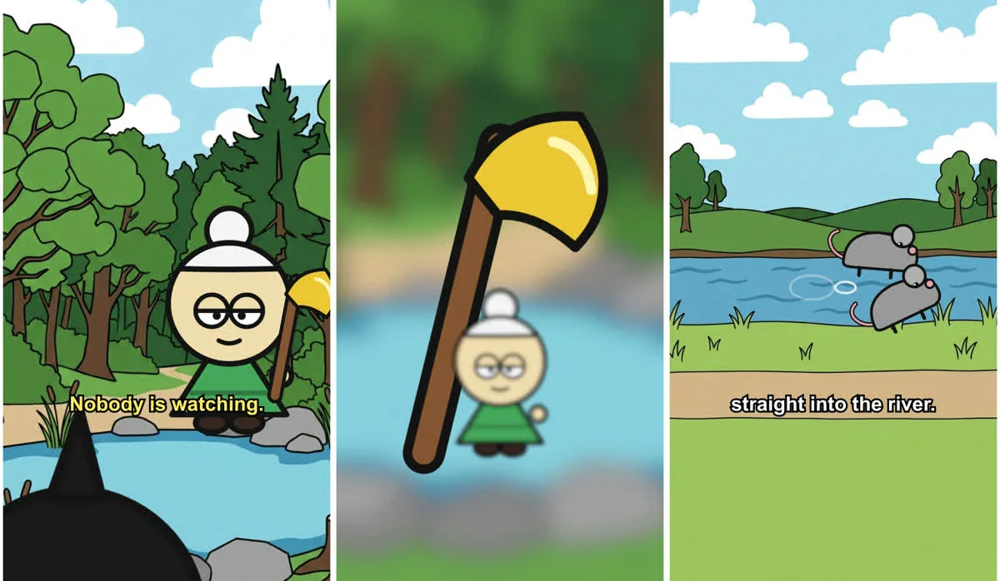
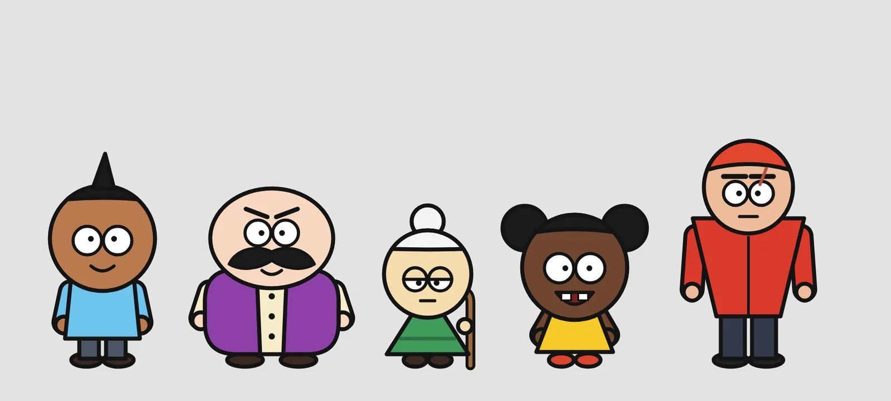
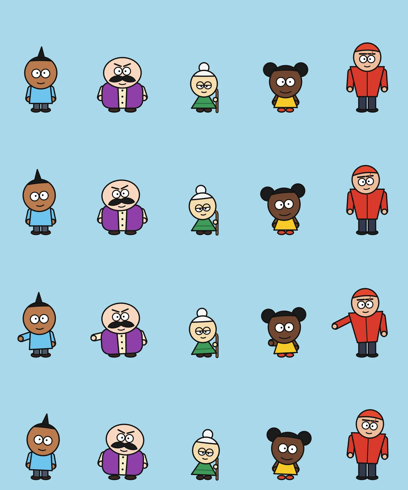
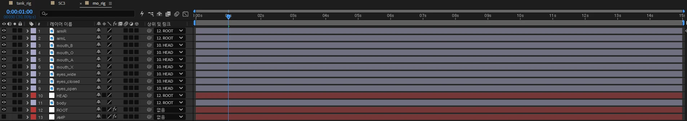
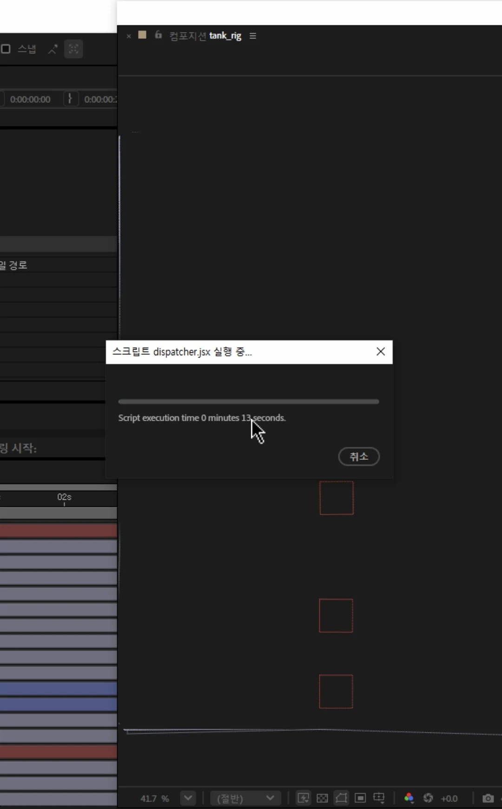
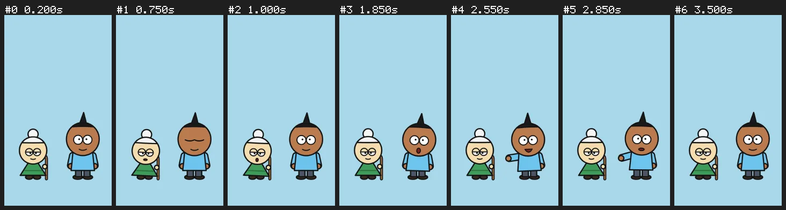
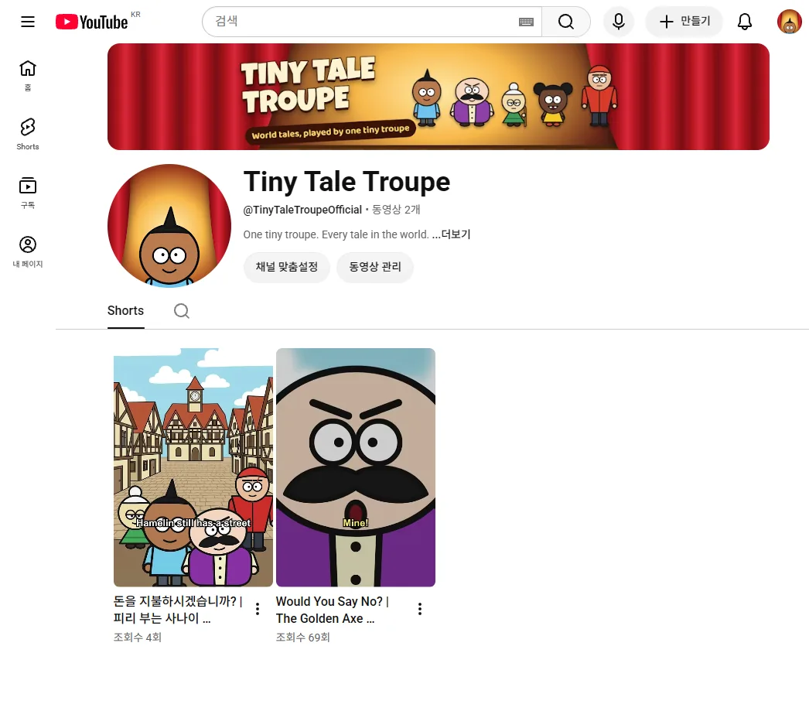

<!-- 사진: 첫 줄 → 완성 장면(07) / 캐릭터 → 주연 다섯(01), AI 세 단계(02) / 리깅 → 조각 나누기(03), 네 방향(04), 이음매(05), 대사 요약판(06) / 채널 → 유튜브(08) -->

애니메이션을 그릴 줄 모르는데, AI와 같이 동화 애니메이션 쇼츠 채널을 하나 열었다. 고정 캐릭터 다섯 명이 매 편 다른 설화를 연기하는 Tiny Tale Troupe다. 캐릭터는 코드로 그리고, 움직임은 에프터이펙트 리깅으로, 배경은 제미나이로 만든다.

<small>1회차 「금도끼 은도끼」의 한 장면. 배경은 제미나이, 인물은 코드로 그려 에펙에서 움직였다</small>

1회차 영상은 여기 있다: [Tiny Tale Troupe 1회차](https://youtube.com/shorts/Rechu83_CdA)

## 다섯 명이 매 편 다른 이야기를 연기한다

틀은 사우스파크에서 빌렸다. 같은 배우들이 편마다 배역과 옷만 바꿔 다른 설화를 연기하고, 첫 줄과 끝 줄에 「너라면?」을 묻는다. 매번 새 캐릭터를 만들 필요가 없고, 보는 사람은 인물에 정이 든다.

<small>주연 다섯 명. 왼쪽부터 모, 바바, 나나, 키키, 탱크</small>

| 인물 | 생김새 | 시청자에게 어떤 존재인가 |
|---|---|---|
| 모 | 마른 20대, 삐죽 솟은 머리, 하늘색 | 「나」. 착하지만 손해 보기 싫고 유혹에 흔들리는 평범한 사람 |
| 바바 | 뚱뚱한 40대, 대머리에 콧수염, 자주색 | 욕하면서 보는 인물. 악당, 왕, 부자 |
| 나나 | 굽은 70대 할머니, 지팡이, 초록색 | 시험을 내는 사람. 현자, 마녀 |
| 키키 | 10살 아이, 양 갈래 머리, 노란색 | 꾀로 바바를 골탕 먹여 속 시원하게 해 주는 인물 |
| 탱크 | 키 큰 30대, 짧은 빨간 머리, 빨간색 | 힘과 규칙. 벽이거나 뜻밖의 편 |

인종·나이·체형을 일부러 다 다르게 잡았다. 세계 사람을 상대로 하는 채널이라서다.

## AI 그림은 매번 다른 사람이 나왔다

처음에는 캐릭터도 AI로 뽑으려 했다. 힉스필드에서 나노 바나나 프로로 바바 한 명을 단순한 정도만 바꿔 세 장 뽑았다.

<small>같은 설명으로 단순함만 바꿔 뽑은 바바 세 장(AI 생성)</small>

세 장 다 나쁘지 않았는데, 문제는 **세 장이 서로 다른 사람**이라는 점이었다. 같은 설명을 넣어도 다시 뽑으면 다른 인물이 나온다. 매 편 같은 배우가 나와야 하는 채널에는 맞지 않았다. 손가락 없는 손을 「mitten hands」(벙어리장갑 손)로 적었더니 진짜 주황 장갑을 끼워 놓은 것도 웃겼다.

그리고 셋 다 움직이기엔 너무 복잡했다. 몸은 덩어리 하나, 큰 흰 눈, 입은 한 줄, 구분은 머리·모자·색으로만 하는 사우스파크 수준이어야 했다. 그래서 그림 도구 대신 파이썬으로 SVG를 직접 그렸다. 크레딧이 0이고, 몇 번을 뽑아도 같은 인물이 나오고, 표정이나 모자를 부품처럼 갈아 끼울 수 있다.

## 조각으로 나눠야 움직인다

처음 시험은 통짜 그림을 통통 튀게 하는 정도였다. 보니까 몸이 부자연스럽게 떨렸다. 컷아웃 애니메이션 리깅을 다시 공부하고 인물을 조각으로 나눴다.

<small>인물 하나를 다리·몸통·머리·팔·눈·입으로 나눴다</small>

모든 조각이 같은 캔버스의 제자리에 있어서 겹치기만 하면 원래 그림이 된다. 팔은 어깨, 머리는 목을 중심으로 돈다. 입은 다문 입, 작게 벌린 입, 크게 벌린 입, 둥근 입 네 장이다.

<small>방향을 돌릴 때는 그림 자체를 바꿔 끼운다. 뒷모습은 눈과 입이 없다</small>

조각을 나누면 이음매가 문제다. 팔을 들면 어깨가 벌어지고, 머리를 갸웃하면 목이 뜬다. 관절 끝을 둥글게 그려 겹치게 하고, 팔·머리를 끝까지 돌린 그림을 한 판에 모아 틈이 보이는지 확인했다.

<small>팔과 머리를 최대로 돌려 이음매가 벌어지지 않는지 본 확인판</small>

## 에펙으로 가져온 이유

처음엔 코드로 움직임까지 뽑고 프리미어에서 조립했다. 그런데 목소리보다 캐릭터 표현이 먼저였다. 말할 때 입이 맞고, 강조하는 단어에서 손이 나가고, 아니라고 할 때 고개를 저어야 사람처럼 보인다. 이걸 장면마다 프리미어에 키프레임으로 찍으면 AI 호출이 장면마다 수십 번이다.

에프터이펙트는 리깅을 한 번 해 두면 나머지를 익스프레션이 알아서 한다. 지금은 대사 음성과 대사 글만 넣으면 이렇게 된다.

| 부위 | 자동으로 되는 것 |
|---|---|
| 입 | 낱말 철자에 맞춰 네 가지 입을 고르고, 소리보다 한 틱 먼저 바꾼다 |
| 눈 | 말하기 직전, 말이 끝난 뒤, 듣는 동안 3초 안팎으로 깜빡인다 |
| 고개·몸 | no·not에서는 고개를 젓고 몸을 뒤로, 물음표에서는 갸웃 |
| 팔 | this·mine·you 같은 말에서 상대 쪽 팔로 가리키고, 느낌표에서는 크게 든다 |

<small>에펙 타임라인. 팔·입·눈·머리 레이어가 HEAD와 ROOT에 부모로 연결돼 있다</small>

<small>클로드가 보낸 스크립트가 에펙에서 도는 중. tank_rig 컴프에 조각이 하나씩 들어온다</small>

<small>대사 한 줄을 일곱 순간으로 잘라 본 것. 눈을 감았다 뜨고, 입이 바뀌고, 가리키는 말에서 팔이 나간다</small>

매 편 내가 정하는 건 장면마다 누가 어느 대사를 하는지 한 줄뿐이다. 움직임은 초당 15번으로 끊었다. 일부러 조금 덜컹거리게 움직이는 쪽이 이 그림체에 맞았다. 에펙은 클로드에 MCP로 연결해서 스크립트를 넣고 장면을 조립한다.

## 배경은 제미나이에 맡겼다

배경은 사람이 들어가지 않으니 AI가 잘한다. 제미나이에 장면을 설명하고, 같은 대화에서 「배치는 그대로 두고 그림체만 단순하게」를 시키는 두 단계로 뽑았다. 1회차 연못가는 처음부터 「딱 좋다」 싶게 나왔다.

삽질도 있었다. 「단순하게, 색 10개」라고 하면 밋밋해지고, 「소품 많고 생활감 있게」라고 하면 사진처럼 나왔다. 지금은 잘 나온 공원 그림 한 장을 같이 올리고 「첨부한 그림과 똑같은 그림체로」라고 한 뒤 장소와 소품 대여섯 개만 적는다. 화면 아래 40%는 인물이 설 자리라 빈 바닥으로 비워 달라고 한다. 오른쪽 아래에 찍히는 제미나이 별 표시는 파이썬으로 지운다.

## 지금까지 네 편

<small>Tiny Tale Troupe 채널</small>

금도끼 은도끼, 피리 부는 사나이, 무지나, 이야기 주머니까지 네 편을 올렸다. 그림을 한 장도 손으로 그리지 않았는데 캐릭터가 말하고 손짓하는 애니메이션이 나온다. 이런 걸 AI로 만들 수 있나 싶었는데, 되긴 된다. 대신 그림을 뽑아 주는 AI보다 같은 인물을 계속 쓰게 해 주는 구조가 더 중요했다.
