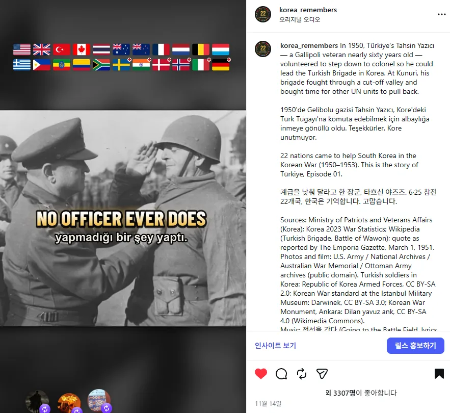
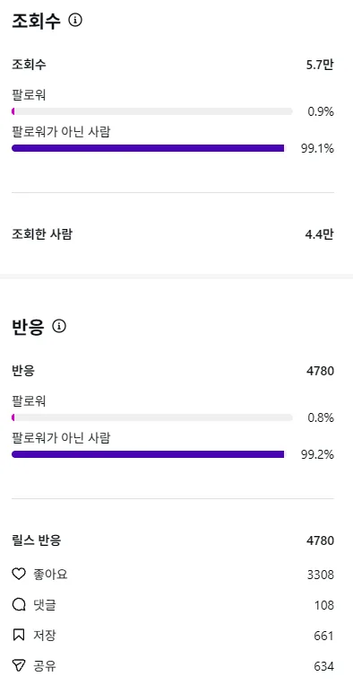
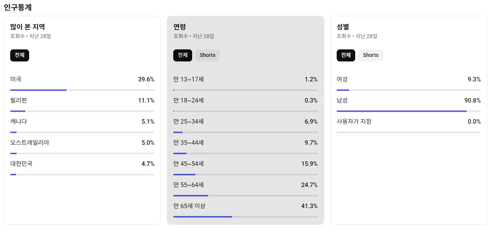

6·25 채널의 인스타 릴스 하나가 튀르키예에서 터졌다. 튀르키예 1화, 계급을 낮춰 달라고 한 장군 타흐신 야즈즈 이야기다. 조회 5.7만, 본 사람 4.4만 명인데 **99.1%가 팔로워가 아닌 사람**이었다. 처음부터 「하나만 걸려라」로 짠 채널이라 기다리던 결과였고, 그래서 **이런 계정을 더 많이 만들고, 더 많이 자동화하기로 했다.**

## 처음부터 「하나만 걸려라」였다

Korea Remembers는 6·25에 군대와 의료진을 보낸 22개국 이야기를 하는 채널이다. 만드는 과정은 [프리미어 MCP 자동화 글](/posts/korea-remembers-automation/)에 적었다.

기획할 때부터 어느 나라에서 터질지 모른다고 봤다.
그래서 한 나라를 노리지 않고, 여러 나라에 한꺼번에 걸어 두는 식으로 짰다.
하나만 걸려라.

## 이번에는 튀르키예였다

의도한 대로 됐다. 반응이 나라마다 고르게 오지 않고, 튀르키예 편 하나가 크게 터졌다.
좋아요 3,308, 댓글 108, 저장 661, 공유 634.

같은 채널 유튜브 쇼츠는 결과가 달랐다. 지난 28일 동안 많이 본 나라는 미국 39.6%, 필리핀 11.1% 순이었다.
플랫폼마다 걸리는 나라도 다르다.

다음에는 어디일지 모른다.
어디서 터질지 맞히려 하기보다 터질 자리를 많이 깔아 두는 게 낫다는 걸, 이번에 눈으로 확인했다.

## 여기서 끝이 아니다

걸린 나라가 정해지면 이제 누가 봤는지가 보인다. 이 릴스를 본 사람은 **98%가 2030 튀르키예 남자**였다.

타겟이 이렇게 또렷하면 할 일도 정해진다. 그들이 좋아할 만한 콘텐츠를 계속 만드는 것이다.
6·25 이야기 사이사이에 무기, 폭탄 같은 이야기를 후속 콘텐츠로 끼워 넣을 계획이다.
한 번 들어온 사람이 다음 편에도 다시 오게 만드는 장치다.

| 단계 | 하는 일 |
|---|---|
| 걸리기 | 22개국에 깔아 둔 콘텐츠 중 한 나라가 터진다(이번엔 튀르키예) |
| 타겟 보기 | 본 사람의 나라·성별·나이를 확인한다(2030 남성 98%) |
| 붙잡기 | 그 타겟이 좋아할 무기·폭탄 이야기를 후속 편으로 끼워 계속 들어오게 한다 |

입구는 6·25 이야기로 열고, 안쪽은 그 나라 그 나이대가 좋아하는 것으로 채운다.

## 그래서 계정도, 자동화도 더 많이

터질 자리를 많이 깔려면 계정이 많아야 한다.
계정이 많아지면 그만큼 손으로 하던 일을 기계에 넘겨야 한다.

그래서 지금 내린 결론은 하나다. **더 많은 계정을, 더 많이 자동화한다.**
