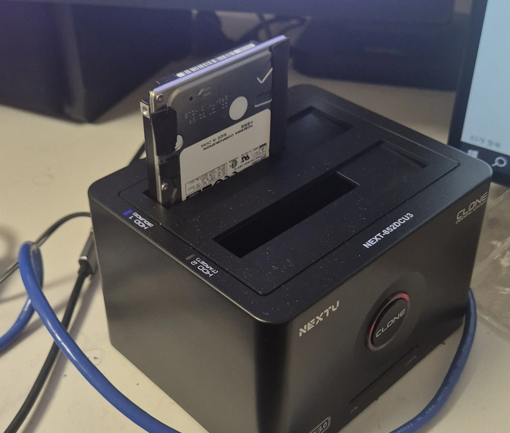
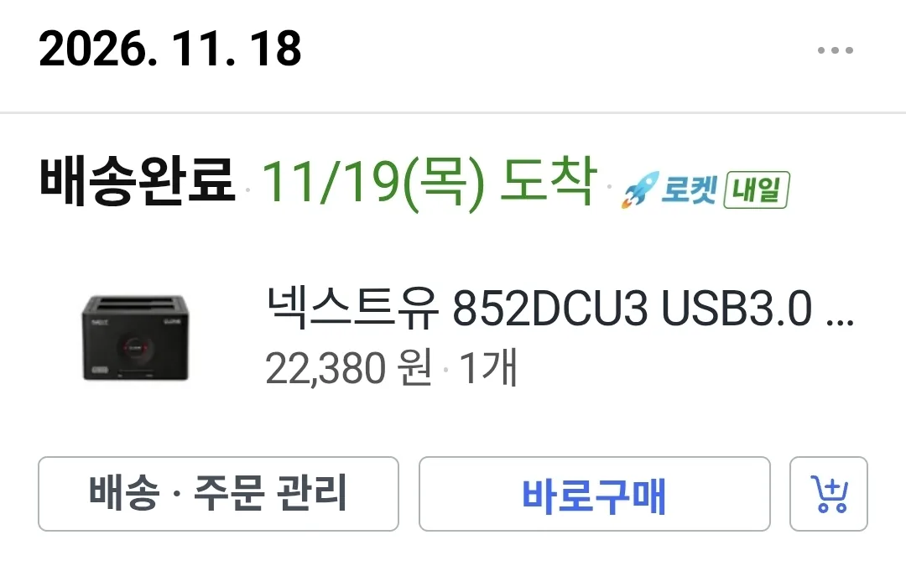

넥스트유 852DCU3 하드 도킹 스테이션을 22,380원에 샀고, 놀던 외장하드에서 꺼낸 하드를 꽂자 **설치 없이 1TB가 바로 생겼다.** 내 돈 주고 산 물건이고 협찬은 없다.

## 산 이유

영상 채널 여러 개를 자동화로 돌리면서 한 달 동안 유튜브에 118개를 공개했다. 그러다 보니 PC 저장 공간이 거의 다 찼다. C 드라이브는 465GB 중 20GB만 남았다.

새 하드를 사자니 요즘 저장장치 값이 계속 오르고 있다. 그래서 집에 굴러다니던 외장하드부터 살리기로 했다. 외장하드 케이스를 열면 안에 2.5인치 노트북용 하드가 들어 있는데, 이걸 꽂을 곳이 필요했다.

## 구매 정보

| 항목 | 내용 |
|---|---|
| 제품 | 넥스트유 NEXT-852DCU3 |
| 산 곳 | 쿠팡 로켓배송 |
| 가격 | 22,380원 |
| 주문·도착 | 11월 18일 주문, 11월 19일 도착 |

## 직접 써 보니

| 항목 | 써 본 결과 |
|---|---|
| 연결 | USB를 꽂자 설치 없이 윈도우에 931GB 드라이브로 바로 떴다 |
| 슬롯 | 「HDD 1(SOURCE)」「HDD 2(TARGET)」 두 칸, 하드 두 개를 같이 꽂을 수 있다 |
| 복제 버튼 | 1번 하드를 2번 하드로 PC 없이 통째로 복사하는 기능이다. 아직 써 보지 않았다 |
| 속도 | USB 3.0. 2GB 파일을 써 보니 초당 약 77MB였다. 오래된 노트북용 하드라 하드 쪽 속도로 보는 게 맞다 |

아쉬운 점은 하드가 위로 드러나 있어 먼지가 앉고, 책상 자리를 차지한다는 것 정도다. 2만 원대로 놀던 하드를 바로 살린 걸 생각하면 충분히 남는 장사였다.

집에 안 쓰는 외장하드나 옛 노트북 하드가 있고 당장 용량이 급하다면 이런 도킹 하나로 버틸 수 있다. 나는 당분간 이걸로 버틴다. 다음 차례는 아내의 2TB 하드인데, 아직 허락은 못 받았다.
