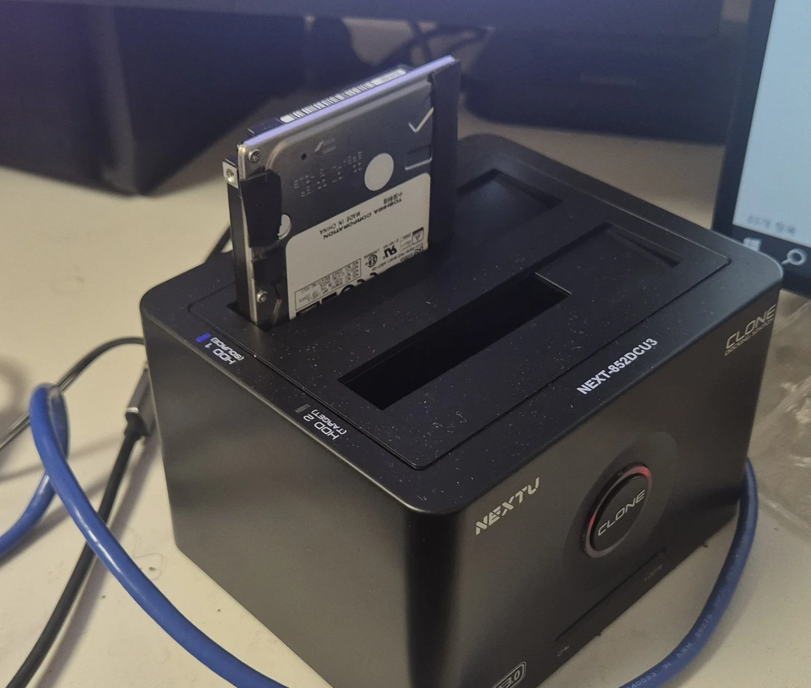
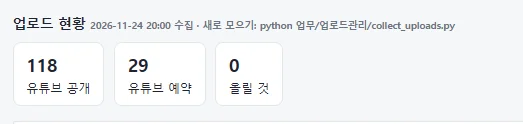
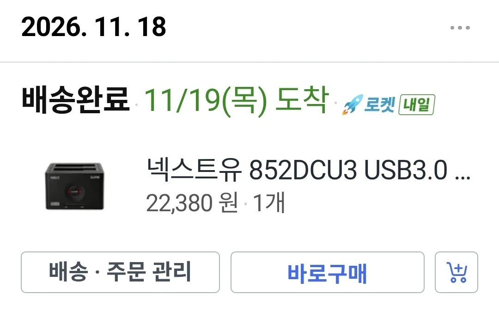

자동화로 채널을 돌리기 시작한 뒤로 **저장 공간이 턱없이 부족해졌다.**
그래서 집에서 놀던 외장하드를 분해해 하드만 꺼내 도킹에 꽂았다. 일단은 이걸로 버틴다.

## 원래는 용량이 늘 남았다

예전에는 저장 공간을 신경 쓸 일이 없었다. 사진과 문서 정도라 하드는 늘 넉넉했다.

달라진 건 영상 채널 여러 개를 자동화로 운영하면서부터다. 영상 한 편을 만들려면 원본 소스, 음성, 배경음악, 중간 렌더 파일, 완성본이 다 따로 쌓인다. 채널이 늘고 언어별 번역본까지 만들다 보니 쌓이는 속도가 예전과 비교가 안 됐다.

## 한 달 동안 유튜브에 118개를 공개했다

| 항목 | 개수 |
|---|---|
| 유튜브 공개 | 118개 |
| 유튜브 예약 | 29개 |

물론 다시 올린 영상과 번역본처럼 겹치는 것도 있다. 그래도 한 달 만에 이 정도다.

지금 내 PC 상태는 이렇다.

| 드라이브 | 전체 | 남은 공간 |
|---|---|---|
| C (SSD) | 465GB | 20GB |
| D (하드) | 1,863GB | 239GB |
| I (새로 붙인 외장하드) | 931GB | 710GB |

C 드라이브는 거의 다 찼고, 작업 파일은 전부 새로 붙인 하드로 옮겼다.

## 집에 놀던 외장하드를 뜯었다

새 하드를 사기 전에 집에 굴러다니던 외장하드부터 꺼냈다. 케이스를 열어 2.5인치 하드만 빼고, 도킹 스테이션에 꽂았다. 이것만으로 1TB가 생겼다.

도킹 스테이션은 11월 18일 쿠팡에서 넥스트유 852DCU3를 22,380원에 샀고, 다음 날 도착했다. 하드를 두 개까지 꽂을 수 있고 복제 버튼도 있다. 새 하드를 사는 것보다 훨씬 싸게 용량을 늘린 셈이다.

도킹 스테이션을 써 본 후기는 [따로 적었다](/posts/review-nextu-852dcu3/).

## 반년 뒤, 그리고 나 같은 사람들

한 달에 이만큼이면 반년 뒤엔 얼마나 올렸을지 감도 안 온다. 그리고 나 같은 사람이 나 하나일 리 없다. AI로 영상을 만들고 올리는 사람이 늘수록 개인의 저장 공간은 더 빨리 바닥날 것이다.

마침 저장장치 값이 계속 오른다는 기사가 많다.

| 내용 | 출처 |
|---|---|
| 웨스턴디지털·시게이트의 2026년 하드 생산분이 사실상 다 팔렸다, 대부분 AI 데이터센터로 | [heise](https://heise.de/-11178917), [The Register](https://www.theregister.com/2026/02/20/ai_blamed_again_as_hard_drives_sell_out/) |
| 독일 소매가 기준 하드 값이 2025년 중반보다 약 20~50% 올랐다 | [heise](https://heise.de/-11178917) |
| 2026년 2분기 하드 거래가가 전 분기보다 10% 올랐다 | [Tech4Gamers](https://www.tech4gamers.com/hard-drive-supply-shortages-get-even-worse/) |
| 데이터센터가 하드 대신 대용량 SSD를 사들여 SSD 값도 오른다 | [Tom's Hardware](https://www.tomshardware.com/pc-components/storage/expect-hdd-ssd-shortages-as-ai-rewrites-the-rules-of-storage-hierarchy-multiple-companies-announce-price-hikes-too) |

데이터센터가 먼저 사 가고, 남은 걸 개인이 나눠 가진다. 그런데 개인 쪽 수요도 나 같은 사람들 때문에 늘고 있다. 저장장치가 더 비싸질 수밖에 없는 이유라고 생각한다.

## 일단은 외장하드로 버틴다

당장 몇 테라짜리를 더 사고 싶다. 하지만 값을 보면 망설여진다. 그래서 당분간은 집에 있는 외장하드들로 버티기로 했다.

솔직히 아내 2TB 하드도 탐내는 중이다.
