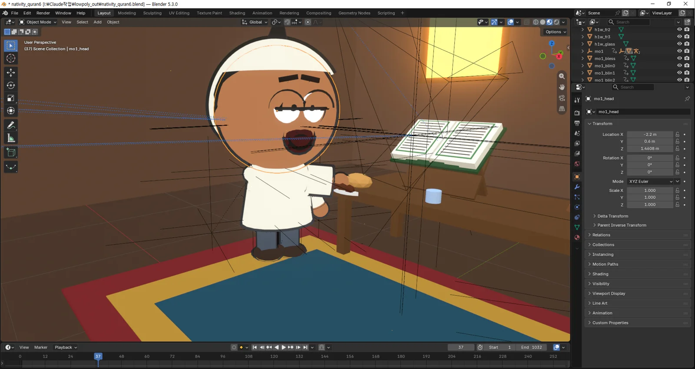
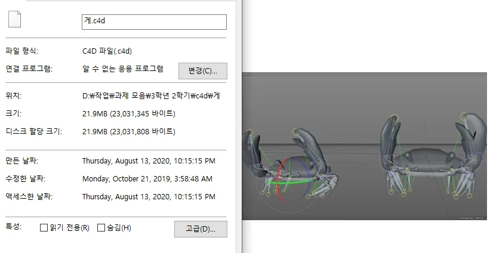
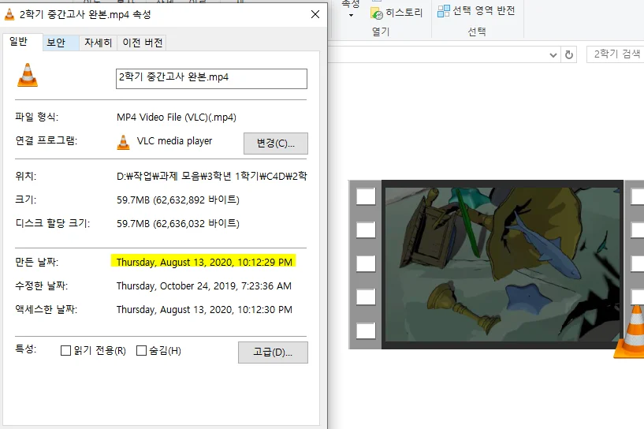
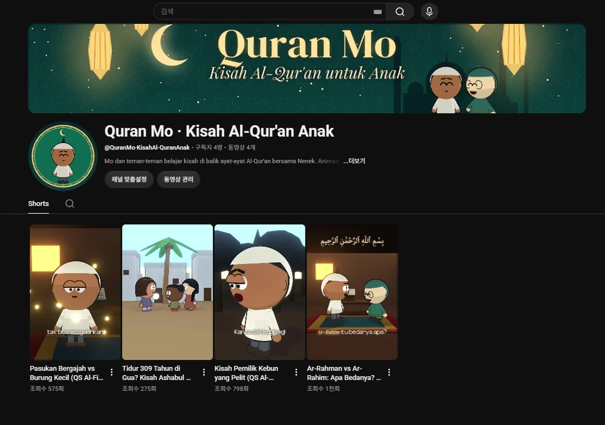
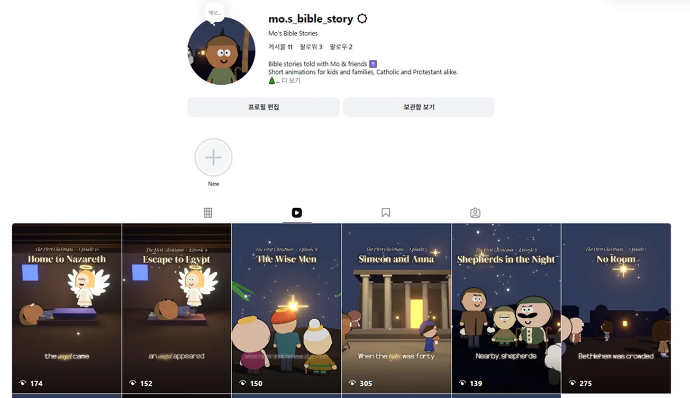

3D 애니메이션 제작을 다시 돌리고 있다. 이번에 고른 주제는 **종교**다. 유행을 안 타고, 쌓아 둘수록 사람을 계속 불러 모을 콘텐츠라고 봤다.

## 학부 때 C4D로 밤새던 기억

학부생 때 C4D로 쓰잘데기 없는 걸 만들며 밤을 많이 샜다. 오랜만에 그때 폴더를 열어 보니 추억이다.

3학년 2학기 중간고사 과제 영상이다. 이 영상은 노래가 포인트라 소리를 켜고 봐야 한다.

<video controls preload="metadata" src="/images/20261125-religion-3d/midterm.mp4" style="width:100%"></video>

옥테인으로 렌더해 본 7초짜리 영상도 하나 남아 있었다.

<video controls muted loop preload="metadata" src="/images/20261125-religion-3d/aung.mp4" style="width:100%"></video>

## 30초에 한 달, 리얼타임에 100만

2학년 때쯤 한창 유튜브 부흥기였다. 유튜브를 열심히 보다가 이런 생각이 들었다.

나보다 100배 잘하는 선배들, 프로 선배들은 3주에서 한 달을 미친 듯이 밤새 30초짜리 하나를 만들어 조회수 5만을 찍는다. 그런데 BJ 유튜버들은 찍는 족족 리얼타임으로 100만, 200만을 찍는다. **이건 수지타산이 안 맞는다.** 그래서 나도 영상 제작 쪽으로 틀었다.

그 선택이 종합 제작 역량을 키우는 쪽으로 이어졌고, 방송국을 지나 지금의 인하우스로 왔다. 오랜만에 다시 3D 툴을 만지니 감회가 새롭다. 사실 직접 만지지는 않았다. 모든 건 AI가 한다.

## 왜 종교 콘텐츠인가

3D로 가장 범용적이면서 유행에 쉽게 사라지지 않고, 사람들이 필요로 하는 콘텐츠가 뭘까 생각했다. 답은 종교였다. 쌓아 두면 점진적으로 사람을 계속 불러 모을 것이고, 구독자와 조회수도 천천히 우상향할 거라고 봤다.

조건을 몇 개 더 붙였다.

| 조건 | 이유 |
|---|---|
| 다른 나라에서 생긴 종교를 믿는다 | 경전 언어가 낯설어 배움이 필요한 사람이 많다 |
| 스마트폰 보급이 많다 | 짧은 영상으로 닿을 수 있다 |
| 자국어 콘텐츠 시장이 크지 않다 | 들어갈 자리가 있다 |

그렇게 고른 것이 **이슬람, 그리고 인도네시아**다. 인도네시아는 세계에서 무슬림이 가장 많은 나라인데, 모국어가 인도네시아어라 아랍어가 생소하다. 그래서 아랍어로 된 꾸란을 인도네시아어로 풀어 주는 채널을 만들었다. 잘 되면 힌디어처럼 필요로 하는 다른 나라 언어로도 넓힐 생각이다.

## 종교 대통합

동시에 성탄절을 앞두고 있어서 크리스천, 가톨릭 형제들을 위한 성경 이야기 콘텐츠도 챙기고 있다. 더 나아가 힌두 콘텐츠도 만들 생각이다.

이게 바로 종교 대통합 아닐까. 고해성사는… 안 하겠다.
