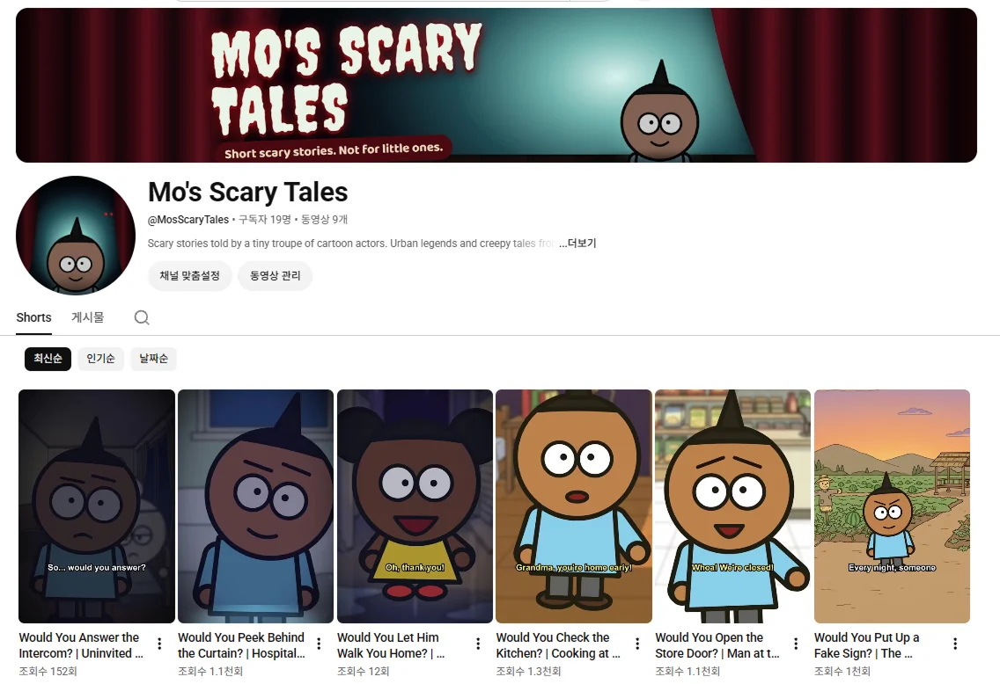
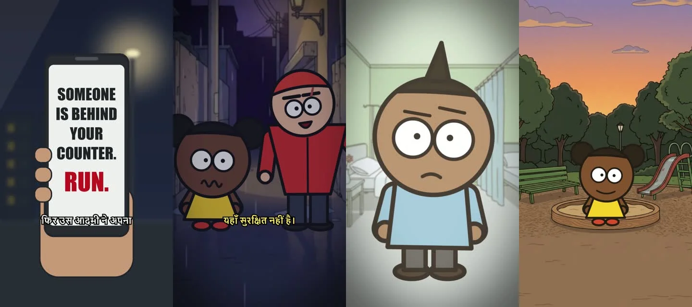

2D로 동화를 만들던 채널을 **공포 채널로 바꿨다.** 시장 돌아가는 꼴을 보니 초등학생쯤 되는 시청자를 잡아야겠더라.

## 가장 잘 참여하는 시청자

로블록스와 SNS를 하면서 커 온 세대라 그런지, 이 친구들은 콘텐츠에 참여를 잘해 준다. 더 많이 몰입하고 댓글도 더 많이 쓴다.

카카오톡 스토리에 들어가 보면 내가 보기엔 댓글의 80% 정도가 초등학생이다. 그리고 그런 초등학생들은 대체로 자극적인 콘텐츠를 좋아한다.

## 그런데 수위는 선을 넘지 않는다

그 수위가 생각보다 높지 않다. 얘네도 아기라서 어느 일정 선은 넘지 않는 것 같다. 기껏해 봐야 마인크래프트, 로블록스 블록 캐릭터에 옷을 짧게 입히는 정도다.

그래서 무섭되 잔인하지 않은 이야기로 간다. 인터폰에 낯선 사람이 나타나거나, 문을 열어 주면 안 되는 밤 같은 이야기다.

## 부모가 추천하는 채널은 포기했다

처음 접근할 때는 부모가 아이에게 추천해 주는 채널이 되길 바랐다. 그런데 애초에 부모들은 아이가 SNS를 하길 바라지 않는다.

어차피 다 뚫고 몰래 들어올 거라면, 그나마 아이들이 소비해도 괜찮을 콘텐츠로 방향을 잡았다. **유해하지 않은 선에서.**
