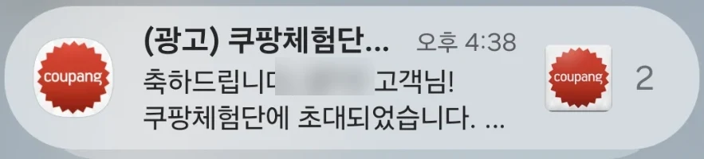
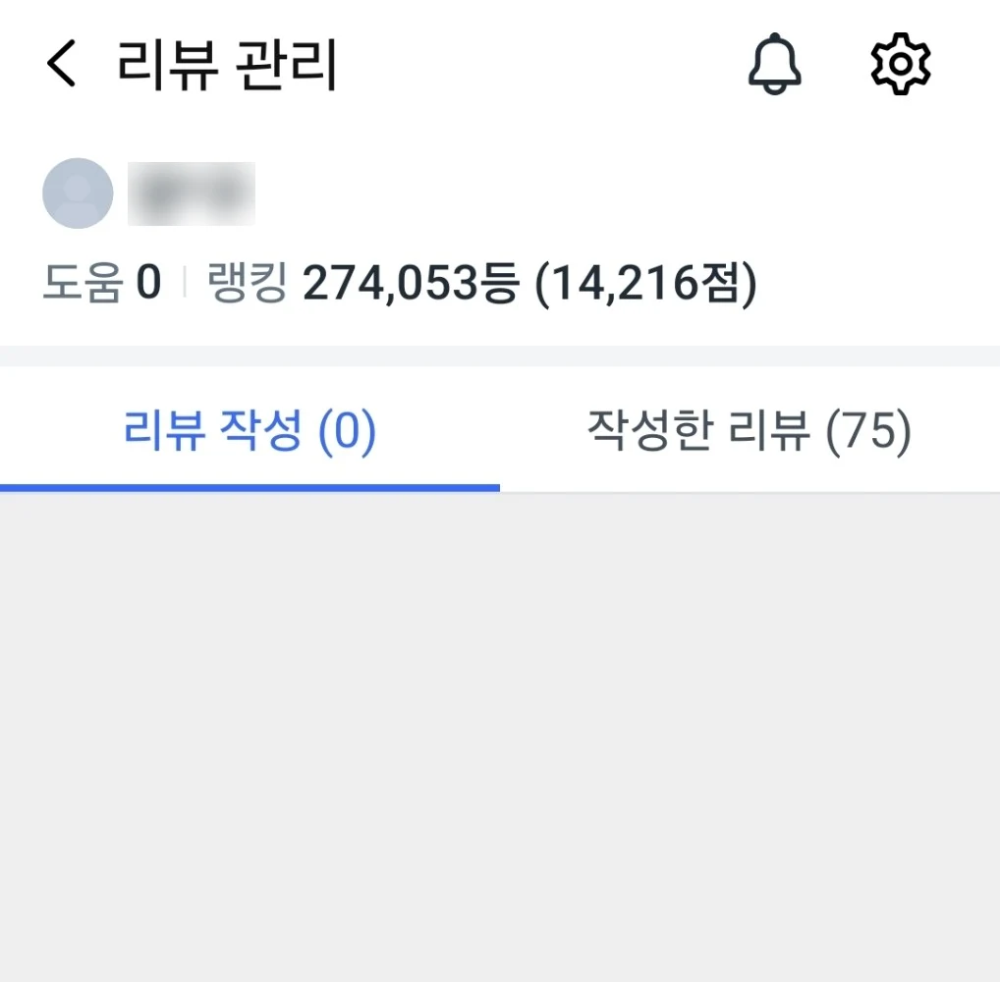
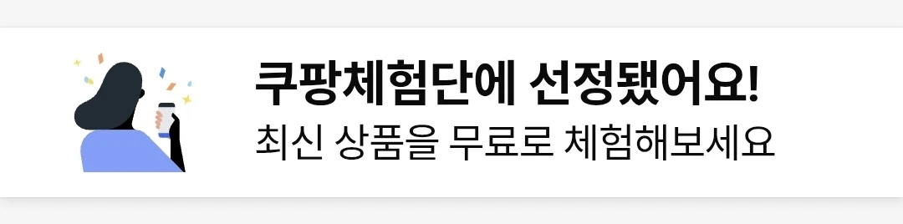
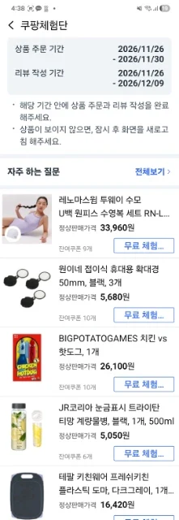

<!-- 사진: 도입 → 휴대폰 초대 알림(이름 흐림) / 한 일 → 작성한 리뷰 75개(이름 흐림) / 선정 → 앱 배너 / 상품 → 체험단 목록 일부 -->

써 둔 리뷰에 사진만 더 올렸더니 다음 날 쿠팡체험단 초대가 왔다.

[지난 글](/posts/coupang-review-gemini-orchestration/)에서 밀린 쿠팡 리뷰를 AI에게 맡겨 쓴 과정을 적었다. 이 글은 그다음 이야기다.

## 글은 있었고 사진이 없었다

리뷰는 자동화로 이미 75개를 써 둔 상태였다. 문제는 사진 없는 리뷰가 많았다는 점이다.

집 안을 한 바퀴 돌며 리뷰를 쓴 물건을 찍었다. 그 사진을 리뷰 10개 정도에 붙였고, 10분이면 끝났다.

## 바로 다음 날 온 알림

| 단계 | 내용 |
|---|---|
| 리뷰 글 | AI 자동화로 미리 작성 |
| 사진 추가 | 리뷰 10개 정도, 10분 |
| 결과 | 다음 날 오후 체험단 초대 |

쿠팡 안내문에는 양질의 상품평을 꾸준히 쓰면 초대 확률이 높아진다고 나온다. 남들도 이렇게 하는지는 모른다. 내 쪽에서 바뀐 건 **사진** 하나였다.

## 상품은 선착순으로 고른다

초대를 받으면 체험단 상품 목록이 열린다. 이번에는 주문이 11월 26일부터 30일까지, 리뷰는 12월 9일까지였다.

상품마다 「무료 체험」 버튼이 있고 하나를 골라 주문한다. 선착순이라 인기 상품은 금방 빠진다. 알림을 보면 쿠폰부터 받아 두는 게 낫다.

초안 키워드는 내가 던졌고 문장 다듬기는 AI가 했다. 마지막 사진 10분은 내 손으로 했다.
